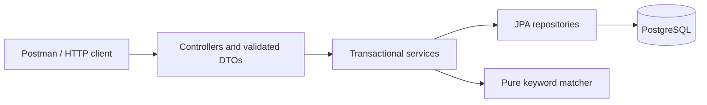

# Technical reference

Detailed API, architecture, configuration and matching behavior. Commands run from the project root.

A small, synchronous Data Loss Prevention backend built with Java 21, Spring Boot, and PostgreSQL. Manage keyword inspection rules, group them into policies, and inspect text against a selected policy.

## Requirements covered

| Assignment requirement | Implementation |
|---|---|
| One backend application and one database | Spring Boot + PostgreSQL in Docker Compose |
| Data Type CRUD | `/api/datatypes` |
| Data Set CRUD | `/api/datasets` |
| Generated UUIDs | Application-generated IDs for both resources |
| Keyword inspection only | `type` accepts only `keywords`, enforced by request validation and a database CHECK |
| Synchronous scan | `POST /api/scan` returns immediately after evaluating the selected policy |
| Whole words and threshold | Literal case-insensitive word matching; a rule passes when count >= threshold |
| OR across rules | A match when any rule passes; all passing rules are returned |
| Required delivery artifacts | Source, `docker-compose.yml`, and a Postman collection are included |

Publish the project to an accessible Git repository and verify reviewer access as part of submission. Repository hosting is separate from running the service locally.

## Run with Docker

Prerequisites: Docker Desktop (Linux containers) or Docker Engine with Compose v2. No local Java, Maven, or database installation is needed.

```sh
docker compose up --build -d --wait
```

The API is available at `http://localhost:8080`. Check readiness:

```sh
curl http://localhost:8080/actuator/health
```

The first build downloads dependencies and runs the unit/API tests. PostgreSQL must become healthy before the application starts. Flyway creates the database schema automatically. The application container runs as an unprivileged user. PostgreSQL is accessible only inside the Compose network; the API binds to localhost.

```sh
docker compose logs -f app
docker compose down
```

Run these commands from the project root, beside `docker-compose.yml`. The database starts empty; demo resources are created by Postman and removed after a successful collection run.

Data survives restarts in a named volume. **`docker compose down -v` deletes the demo database.** Optional local settings are in `.env.example`; copy it to `.env` to change `APP_PORT` or `DB_PASSWORD`. These are local demo credentials, not production secrets. Changing `DB_PASSWORD` after PostgreSQL has initialized its volume does not change the existing database password; update the database credentials consistently instead of assuming the environment setting resets them.

## Try the complete workflow

Import `postman/mini-dlp.postman_collection.json` into Postman. Its `baseUrl` defaults to `http://localhost:8080`; an optional environment is included. Use Collection Runner in the provided order. The collection creates rules and policies, captures their IDs automatically, exercises scan/CRUD/error scenarios, and cleans up its own resources. Individual scan requests require the create requests to have run first.

Alternatively, with Node.js available:

```sh
npx --yes newman@6 run postman/mini-dlp.postman_collection.json
```

The expanded collection contains 46 requests and 65 assertions. With Node.js 22+, `node scripts/verify-http.mjs` additionally verifies 120 scans in batches of eight concurrent requests, then removes its temporary resources. This is a correctness smoke test, not a capacity benchmark.

For another API port, change Postman `baseUrl` or pass `--env-var baseUrl=http://localhost:8081` to Newman. The HTTP script accepts `DLP_BASE_URL`; for example in PowerShell:

```powershell
$env:DLP_BASE_URL = "http://localhost:8081"
node scripts/verify-http.mjs
```

Each HTTP script request has a 15-second timeout. A batch settles fully before cleanup, so one failed request cannot trigger deletion while other requests in that batch are still being processed.

### Request examples

`POST /api/datatypes`:

```json
{
  "name": "Sensitive Keywords",
  "description": "Demo terms",
  "type": "keywords",
  "content": [
    "password",
    "secret",
    "confidential",
    "token",
    "credential",
    "apikey",
    "privatekey",
    "classified"
  ],
  "threshold": 3
}
```

Use the returned UUID in `POST /api/datasets`:

```json
{
  "name": "Outbound Policy",
  "data_type_ids": [
    "<data-type-uuid>"
  ]
}
```

Use the policy UUID in `POST /api/scan`:

```json
{
  "text": "SECRET secret password secretary",
  "data_set_id": "<data-set-uuid>"
}
```

Response:

```json
{
  "status": "match",
  "detected_objects": [
    {
      "id": "<data-type-uuid>",
      "name": "Sensitive Keywords",
      "match_count": 3
    }
  ]
}
```

Below the threshold, the response is exactly `{"status":"not matched"}`. Scan requests do not persist input text or results. The application does not log request bodies or matched content.

### Optional inspection explanations

Set `"include_details": true` in the scan request to explain why each selected rule passed or failed. This optional extension leaves the default assignment response unchanged. Omitting the field, setting it to `false`, or using `null` disables details; other non-boolean values are rejected.

```json
{"text":"SECRET secret password secretary","data_set_id":"<data-set-uuid>","include_details":true}
```

The response includes the policy name/ID, each rule's threshold, full count, decision, English explanation and per-keyword occurrence counts:

```json
{
  "status": "match",
  "detected_objects": [
    {
      "id": "<data-type-uuid>",
      "name": "Sensitive Keywords",
      "match_count": 3
    }
  ],
  "inspection_details": {
    "data_set_id": "<data-set-uuid>",
    "data_set_name": "Outbound Policy",
    "reason": "At least one Data Type reached its own threshold (OR logic).",
    "rules": [
      {
        "id": "<data-type-uuid>",
        "name": "Sensitive Keywords",
        "threshold": 3,
        "match_count": 3,
        "matched": true,
        "reason": "Whole-word match count 3 is at least threshold 3.",
        "matched_keywords": [
          {
            "keyword": "password",
            "match_count": 1
          },
          {
            "keyword": "secret",
            "match_count": 2
          }
        ]
      }
    ]
  }
}
```

All evaluated rules appear in `inspection_details.rules`, including rules below their thresholds. Only passing rules appear in `detected_objects`. An empty policy has an empty explanation rule list and an explicit reason. Keywords absent from the text are omitted from `matched_keywords`. Explanations return configured keyword values and counts; they do not return the submitted text, surrounding excerpts or sensitive values beyond the configured terms. Detailed and compact scans use the same counting pass and the same one-query policy load.

## API contract

| Method | Path | Success |
|---|---|---|
| POST | `/api/datatypes` | 201, resource + Location header |
| GET | `/api/datatypes` | 200, array |
| GET | `/api/datatypes/{id}` | 200, resource |
| PUT | `/api/datatypes/{id}` | 200, full replacement |
| DELETE | `/api/datatypes/{id}` | 204 |
| POST | `/api/datasets` | 201, resource + Location header |
| GET | `/api/datasets` | 200, array |
| GET | `/api/datasets/{id}` | 200, resource |
| PUT | `/api/datasets/{id}` | 200, full replacement |
| DELETE | `/api/datasets/{id}` | 204 |
| POST | `/api/scan` | 200, inspection result |
| GET | `/actuator/health` | 200 when ready |

List endpoints accept `page` (zero-based, default 0) and `size` (1–100, default 50), with deterministic UUID ordering. Offsets beyond the signed integer range supported by JPA return 400. The API uses explicit snake_case relationship fields (`data_type_ids`, `data_set_id`); unknown JSON properties are rejected to expose typos. UUIDs are generated by the application; clients cannot set them.

Errors use `application/problem+json`: `400` for invalid input, malformed JSON/UUIDs, unknown rule references, or duplicate IDs; `404` for an unknown resource/endpoint; `405` for unsupported HTTP methods (with an Allow header); `415` for unsupported content types; `409` for deleting a referenced rule or a concurrent referential-integrity conflict. Field-constraint failures on JSON request bodies include an `errors` array; parsing and business errors use a safe `detail` message. Database internals and submitted text are not included in error responses. Numeric strings and fractional values are rejected for integer thresholds instead of silently converted.

### Input validation

| Resource | Required input and bounds |
|---|---|
| Data Type | Nonblank `name` (max 120), `description` (max 1,000; empty allowed), `type: "keywords"`, 1–100 nonblank keywords (max 100 each), positive integer `threshold` |
| Data Set | Nonblank `name` (max 120), `data_type_ids` array (0–100 existing, unique UUIDs) |
| Scan | `text` (0–100,000 UTF-16 code units), existing `data_set_id` UUID |

JSON `null` is rejected for required fields. `PUT` replaces all editable fields; omitted required fields are not treated as a partial update. Names/descriptions are trimmed, and keywords are normalized before storage. Text is inspected in memory without saving a scan history.

An invalid request returns a Problem Detail object, for example:

```json
{
  "type": "about:blank",
  "title": "Bad Request",
  "status": 400,
  "detail": "Request validation failed",
  "instance": "/api/datatypes",
  "errors": [
    "threshold: must be greater than or equal to 1"
  ]
}
```

## Explicit matching decisions

The assignment leaves several details open. This implementation uses:

* **Case-insensitive matching**, with Unicode support and NFC normalization. Keywords are trimmed and NFC-normalized while preserving their spelling and order. Duplicate detection uses Java's Unicode-aware case-insensitive string comparator, so equivalent forms such as Greek sigma variants cannot inflate counts. Avoiding forced lowercase also prevents characters such as `İ` from being expanded or changing the configured literal.
* **Explicit assumption (the assignment does not specify this): repeated occurrences count as separate matches**, not distinct keywords: `secret secret` counts as two. All keywords within a rule contribute to its count. Each rule has its own positive integer threshold.
* **Whole-word boundaries**: letters, Unicode combining marks, numbers and underscore are word characters. `secret!` matches; `secretary`, `secret2`, and `_secret` do not. A hyphen is a separator. User keywords are quoted as literals, never executed as regex syntax.
* Phrases and punctuation are allowed as literal keywords. Internal whitespace is exact. Distinct overlapping keywords count independently (`secret` and `top secret` each match `top secret`). Occurrences of the same keyword are non-overlapping.
* **OR across rules**: every passing rule is returned, ordered by UUID. The full count is calculated even after a threshold is met.
* An empty policy is allowed and never matches. Empty text is valid and never matches. Missing policy: 404. Unknown IDs in a policy: 400.
* Rule updates apply to every policy referencing the rule. Deletion of referenced rules is rejected; remove references or delete the policy first. A database foreign key also enforces this under concurrent requests.

### Demo keyword examples (threshold = 3)

The Postman demo rule contains `password`, `secret`, `confidential`, `token`, `credential`, `apikey`, `privatekey`, and `classified`. These are example configuration values, not hardcoded detection rules or automatically seeded database records.

| Input text | Whole-word occurrences | Result |
|---|---:|---|
| `public information` | 0 | not matched |
| `Secret` | 1 | not matched |
| `secret password` | 2 | not matched |
| `secret secret password` | 3 | match |
| `Secret SECRET secret SeCrEt` | 4 | match |
| `password secret confidential token credential apikey privatekey classified` | 8 | match |
| The eight words above, followed by `secret password` | 10 | match |
| `passwords secretary confidentiality tokens credentials apikeys privatekeys unclassified` | 0 | not matched |

Repeated occurrences in **input text** count separately. Duplicate entries in a rule's **keyword configuration** are rejected after NFC normalization and case-insensitive comparison, preventing accidental double counting. Punctuation separates words; substrings inside longer words, numbers or underscore do not match.

## Project layout

```text
src/main/java/com/nadav/dlp/
  datatype/       Rule entities, DTOs, CRUD service, repository and HTTP controller
  dataset/        Policy membership and its CRUD API
  scan/           Whole-word matcher and synchronous inspection flow
  common/         Business errors and shared HTTP error translation
src/main/resources/
  application.yml Runtime configuration and environment overrides
  db/migration/   Versioned Flyway schema migration
src/test/         Matcher, API, SQL query-count and real PostgreSQL tests
postman/          Runnable collection and optional local environment
scripts/          Concurrent HTTP correctness check
docs/             Test matrix and verified execution results
.github/workflows/ci.yml
                  Automated build, PostgreSQL, Docker and HTTP checks
```

The application classes include short English responsibility comments. Method comments explain transaction boundaries, matching assumptions and non-obvious behavior rather than repeating getter/setter names.

## Architecture



Feature packages: `datatype`, `dataset`, `scan`; shared error handling is in `common`. Controllers handle HTTP, services implement business rules and transaction boundaries, repositories provide persistence. DTOs keep the API independent of JPA and prevent recursive relationship serialization. No Lombok or generic service framework is needed.

The relational model contains `data_types`, ordered `data_type_keywords`, `data_sets`, and the `data_set_types` many-to-many join table. Policies reuse rules without copying them. There are no cascading rule deletes. Flyway owns schema changes; Hibernate validates, rather than modifies, the schema at startup. Applied migration files are immutable: add a new migration for a later schema change instead of editing an existing migration and invalidating its checksum.

Scan runs in a read-only **REPEATABLE READ** transaction: policy membership and keyword loads use one consistent PostgreSQL snapshot while concurrent edits occur. CRUD writes are atomic transactions. Concurrent updates to the same resource currently use last-writer-wins; optimistic locking is a possible extension.

The straightforward scanner runs approximately O(total selected keywords × text length), plus pattern compilation. Input is limited to 100,000 UTF-16 code units, 100 keywords per rule, 100 characters per keyword, and 100 rules per policy. This is appropriate for a small synchronous assignment, not a throughput guarantee. Scans fetch policy membership, rules and ordered keywords with one explicit collection-fetch query; a regression test checks query count and correct counts across 20 rules. The join expands to one row per policy keyword, bounded by the request limits. Collection fetches are intentionally excluded from paginated lists, whose DTO mapping may still issue additional queries. Large workloads would justify measured limits and a multi-pattern matcher such as Aho–Corasick.

## Build and test

For development install JDK 21+ and Maven 3.9+:

```sh
mvn test
mvn verify
```

Maven Wrapper scripts are included: use `./mvnw verify` on Linux/macOS or `.\mvnw.cmd verify` in PowerShell if Maven is not installed. The first wrapper run downloads Maven. Docker remains the simplest way to run the application.

`mvn test` runs deterministic matcher tests, full HTTP/controller/service/database tests against H2 in PostgreSQL compatibility mode, and a scan query-count regression test. It uses the real Flyway migration and does not need Docker. `mvn verify` additionally runs the entire API contract suite again on real PostgreSQL (`PostgresApiIT`), plus database foreign-key and concurrent scan tests (`PostgresIT`). The PostgreSQL classes explicitly skip without Docker. H2 is a test dependency only, never the deployed database. See `TESTING.md` for the test matrix.

GitHub Actions runs verification on Java 21, then builds/starts Compose and runs the Postman collection using Newman. See `VERIFICATION.md` for what was actually verified during preparation; a workflow file alone does not mean CI has passed.

For local Java debugging, start PostgreSQL separately and configure `DB_URL`, `DB_USER`, `DB_PASSWORD`, then run `mvn spring-boot:run`. The normal Compose database does not publish a host port.

## Troubleshooting

* **Docker is unavailable:** confirm Docker Desktop is running with Linux containers. `docker version` should include a Server section.
* **Port 8080 is occupied:** set `APP_PORT=8081` in `.env`, start Compose again and update the client base URL.
* **A container is unhealthy:** inspect `docker compose ps` and `docker compose logs app db`; common causes include an unavailable database or credentials inconsistent with an existing volume.
* **Postman cannot find a policy:** run the collection in order so generated IDs are captured before scans.
* **PostgreSQL tests are skipped:** run `mvn verify` with a reachable Docker engine. A successful `mvn test` alone does not exercise PostgreSQL.

## Scope and tradeoffs

This is the requested single backend and single database, without a frontend, queues, microservices, or asynchronous scans. Authentication, authorization, audit trails, TLS termination, distributed rate limiting, and a hardened request-body byte limit belong in a production deployment; they are not implemented here. This demo is intended for local evaluation. Do not expose it publicly as a DLP production system.

## Deliverables

* Source, Maven build, SQL migration, tests
* Multi-stage Dockerfile and Compose configuration verified with PostgreSQL, healthchecks, and persistent storage
* Postman collection with assertions and optional environment
* CI workflow, architecture/behavior documentation, test matrix and verification report

The deliverables include all source code, Docker Compose configuration, and a Postman collection. See `TESTING.md` for the test matrix and `VERIFICATION.md` for verified results.
